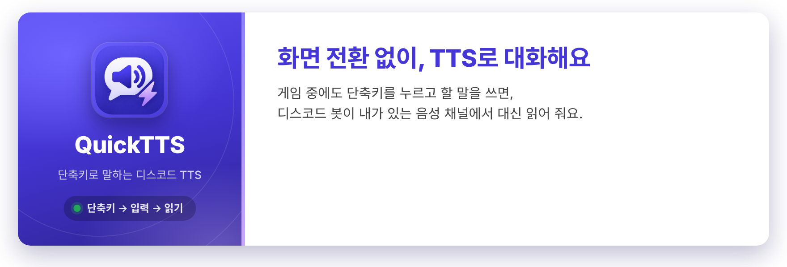

# discord-quick-tts

단축키 한 번으로 입력창을 띄워 문장을 치면, 디스코드 봇이 내가 있는 음성 채널에서 읽어 주는 TTS 봇입니다.

```
[디스코드] /연결 → 나만 보이는 연결 코드
[PC] 첫 실행 때 코드 입력 → POST /api/v1/devices → 이 PC 전용 기기 토큰 저장

[PC] Ctrl+Shift+Space → 입력 위젯 → Enter
        │  POST /api/v1/quick-chat (Authorization: Bearer <기기 토큰>)
        ▼
[bot-server] 토큰 주인이 있는 음성 채널을 찾아 TTS 로 읽어 줌
```

## 시작하기

봇이 들어와 있는 디스코드 서버에서 쓰는 방법입니다. 디스코드에서 `/도움말` 을 입력하면 같은 안내를 나만 보이게 받을 수 있습니다.

1. **PC 앱 설치**: [Releases](https://github.com/phs314/discord-quick-tts/releases/latest) 에서 `QuickTTS-*.exe` 를 받아 실행합니다. 서명하지 않은 앱이라 Windows 가 "알 수 없는 게시자" 경고를 띄우면 "추가 정보" → "실행" 을 누르세요.
2. **연결**: 디스코드에서 `/연결` 을 입력하면 나만 보이는 코드가 옵니다. 앱이 처음 켜질 때 묻는 칸에 붙여 넣으세요. 코드는 5분 동안 한 번만 쓸 수 있습니다.
3. **말하기**: 음성 채널에 들어간 뒤 `Ctrl+Shift+Space` 를 누르면 입력창이 뜹니다. 문장을 쓰고 Enter 를 치면 봇이 그 채널에 들어와 읽어 줍니다. Esc 를 누르면 닫힙니다.

| 디스코드 명령 | 하는 일 |
| --- | --- |
| `/연결` | PC 앱을 연결할 코드를 받습니다. |
| `/연결해제` | 연결한 PC 를 골라 끊습니다. |
| `/목소리` | 내 문장을 읽어 줄 목소리(선희, 인준, 현수, 구글 번역)를 고릅니다. |
| `/도움말` | 시작 순서와 명령 목록을 봅니다. |

- 단축키는 작업 표시줄 트레이의 Quick TTS 아이콘 메뉴 **Change Keybind...** 에서 바꿉니다. **Start with Windows** 를 켜면 윈도우에 로그인할 때 앱이 같이 켜지고, 끌 때는 **Exit** 를 누릅니다.
- 같은 디스코드 서버에서 봇이 이미 다른 음성 채널에서 읽고 있으면, 그 채널이 빌 때까지 입력창에 안내가 뜨고 읽지 않습니다.
- 봇을 내 디스코드 서버에 들이려면 봇 주인에게 허용을 부탁하세요 ([허용 목록](#봇을-들일-디스코드-서버-허용-목록)).

## 모듈

저장소 맨 위는 띄우는 프로그램(`apps/`), 앱끼리 나눠 쓰는 코드(`libs/`), 모든 모듈이 같이 쓰는 빌드 설정(`build-logic/`)으로 나뉩니다 ([ADR 0045](docs/adr/0045-apps-libs-build-logic-layout.md)).

| 모듈 | 내용 |
| --- | --- |
| `apps/bot-server` | Spring Boot + JDA + LavaPlayer. `/연결` 명령, 기기 등록, quick chat API 를 맡습니다. |
| `apps/desktop-client` | JavaFX 입력 위젯 + JNativeHook 전역 단축키 + 트레이 아이콘. |
| `libs/api-contract` | 데스크톱 앱과 봇 서버가 함께 쓰는 웹 API 약속(경로, 요청·응답 형식, 오류 코드). 패키지는 `io.github.phs314.quicktts.api` 입니다. |
| `build-logic` | 규칙 플러그인 `quicktts.java`(JDK 25, UTF-8, JUnit 5)와 `quicktts.spring-app`(스프링 부트 앱). 버전은 `gradle/libs.versions.toml` 하나에서 정합니다. |

## 봇 서버 구조 (바운디드 컨텍스트 + 헥사고날)

봇 서버는 다섯 바운디드 컨텍스트로 나뉘고, 각 컨텍스트 안은 헥사고날(도메인 / 포트 / 어댑터)로 나뉩니다. 도메인 용어는 [CONTEXT.md](CONTEXT.md), 구조를 이렇게 정한 이유는 [docs/adr](docs/adr) 에 있습니다.
ADR 목록과 상태(채택, 일부 대체됨), 새 ADR 을 쓰는 법은 [docs/adr/README.md](docs/adr/README.md) 에 있습니다.

| 컨텍스트 | 다루는 것 |
| --- | --- |
| `speech` (핵심) | 누가 무슨 문장을 어느 음성 채널에서 읽게 하나 |
| `settings` (지원) | 사용자가 고른 설정 (지금은 `/목소리` 로 고른 목소리) |
| `synthesis` (일반) | 문장을 음성으로 만드는 TTS 엔진과 목소리 목록 |
| `identity` (지원) | 이 PC 가 어느 디스코드 사용자의 것인가 (`/연결` 코드 발급, 기기 등록, 기기 인증) |
| `guild` (지원) | 봇이 어느 디스코드 서버에 머물러도 되나 (허용 목록, 봇 주인 확인) |
| `shared` | 여러 컨텍스트가 함께 쓰는 공유 커널 (`DiscordUserId`, `GuildId`, `VoiceId`, 도메인 검증 예외) |

```
apps/bot-server/src/main/java/io/github/phs314/quicktts/bot/
├── speech/
│   ├── domain/                 BotVoiceState (디스코드 서버별 봇 음성 상태, 애그리거트)
│   │   └── vo/                 QuickChatMessage, SpokenText, VoiceChannel, Audio (값 객체)
│   ├── application/
│   │   ├── exception/          AuthorNotInVoiceChannel, VoiceChannelInUse, BotCannotJoinVoiceChannel, UnplayableAudio 예외
│   │   ├── port/in/            SpeakQuickChat, FindCurrentUserVoiceChannel, LeaveEmptyVoiceChannel, SyncBotVoiceState, ClearBotVoiceState (...UseCase, 메서드 하나씩)
│   │   ├── port/in/command/    SpeakQuickChat, LeaveEmptyVoiceChannel, SyncBotVoiceState, ClearBotVoiceState (...Command)
│   │   ├── port/in/query/      FindCurrentUserVoiceChannel (...Query)
│   │   ├── port/out/           VoiceStatePort, SpeechPlayerPort, BotVoiceStatePort, UserVoicePort, TextToSpeechPort
│   │   └── service/            입력 포트마다 하나 (SpeakQuickChatService 등)
│   └── adapter/
│       ├── in/web/             quick chat REST 컨트롤러와 웹 매퍼
│       ├── in/discord/         음성 채널 입·퇴장 소식, 봇이 디스코드 서버에서 나간 소식
│       ├── out/discord/        JDA + LavaPlayer 로 채널 찾기, 들어가기·재생·나가기
│       ├── out/memory/         봇 음성 상태 저장소 (메모리)
│       ├── out/settings/       settings 에 사용자가 고른 목소리 묻기
│       └── out/synthesis/      synthesis 에 음성 만들어 달라고 하기
├── settings/
│   ├── domain/                 UserSettings (사용자 설정, 애그리거트), UnknownVoiceException
│   │   └── vo/                 VoiceChoice, VoiceChoices (고를 수 있는 목소리와 기본 목소리)
│   ├── application/
│   │   ├── port/in/            GetUserSettings (speech 도 부름), GetVoiceChoices, ChangeVoice (...UseCase)
│   │   ├── port/in/command/    ChangeVoice (...Command)
│   │   ├── port/in/query/      GetUserSettings (...Query)
│   │   ├── port/in/dto/        UserSettingsDto
│   │   ├── port/out/           UserSettingsPort, VoiceChoicesPort
│   │   └── service/            입력 포트마다 하나
│   └── adapter/
│       ├── in/discord/         /목소리 슬래시 명령
│       ├── out/persistence/    사용자 설정 저장소 (JPA 엔티티 + 매퍼)
│       └── out/synthesis/      synthesis 에 목소리 목록 묻기
├── synthesis/
│   ├── domain/vo/              Voice, VoiceCatalog, Audio (값 객체)
│   ├── application/
│   │   ├── exception/          SpeechSynthesisException
│   │   ├── port/in/            GetVoices (settings 가 부름), SynthesizeSpeech (speech 가 부름) (...UseCase)
│   │   ├── port/in/command/    SynthesizeSpeech (...Command)
│   │   ├── port/in/dto/        VoiceDto, VoiceCatalogDto, AudioDto
│   │   ├── port/out/           SpeechSynthesizerPort
│   │   └── service/            입력 포트마다 하나
│   └── adapter/
│       └── out/tts/            TTS 엔진 (Edge, Google 번역), 엔진 고르기, 결과 캐시와 지표
├── identity/
│   ├── domain/                 Pairing, Device (엔티티), InvalidPairingCodeException
│   │   └── vo/                 PairingCode, DeviceToken, DeviceId, DeviceName (값 객체)
│   ├── application/
│   │   ├── port/in/            IssuePairingCode, RegisterDevice, AuthenticateDevice, GetDevices, UnlinkDevice, UnlinkAllDevices (...UseCase, port/in 전체가 공개 입구)
│   │   ├── port/in/command/    IssuePairingCode, RegisterDevice, UnlinkDevice, UnlinkAllDevices (...Command)
│   │   ├── port/in/query/      AuthenticateDevice, GetDevices (...Query)
│   │   ├── port/in/dto/        DeviceDto, IssuedPairingCodeDto
│   │   ├── port/out/           PairingPort, DevicePort
│   │   └── service/            입력 포트마다 하나 (RegisterDeviceService 등)
│   └── adapter/
│       ├── in/web/             기기 등록 REST 컨트롤러와 웹 매퍼, 기기 토큰 인증 필터
│       ├── in/discord/         /연결 슬래시 명령
│       ├── out/persistence/    기기 저장소 (JPA 엔티티 + 매퍼)
│       └── out/memory/         연결 코드 저장소 (메모리)
├── guild/
│   ├── domain/                 AllowedGuild (허용한 디스코드 서버)
│   │   ├── vo/                 GuildAllowlist (허용 목록으로 머물 곳 정하기)
│   │   └── event/              GuildRemovedFromAllowlist (허용 목록에서 뺐다)
│   ├── application/
│   │   ├── exception/          NotBotOwnerException
│   │   ├── port/in/            GetAllowlist, AddToAllowlist, RemoveFromAllowlist, LeaveNotAllowedGuild, SeedAllowlist, LeaveAllNotAllowedGuilds (...UseCase)
│   │   ├── port/in/command/    AddToAllowlist, RemoveFromAllowlist, LeaveNotAllowedGuild (...Command)
│   │   ├── port/in/query/      GetAllowlist (...Query)
│   │   ├── port/in/dto/        AllowedGuildDto, GuildAllowlistDto
│   │   ├── port/out/           AllowedGuildPort, JoinedGuildPort, BotOwnerPort, GuildAllowlistConfigPort, GuildAllowlistEventPort
│   │   └── service/            입력 포트마다 하나
│   └── adapter/
│       ├── in/discord/         /허용목록 슬래시 명령, 초대·시작 때 확인
│       ├── in/event/           허용 목록에서 빼면 커밋 뒤에 그 서버에서 나가기
│       ├── out/discord/        봇이 들어가 있는 서버 보기·나가기, 봇 주인 알아내기
│       ├── out/event/          허용 목록 이벤트 내기 (스프링 이벤트)
│       ├── out/persistence/    허용 목록 저장소 (JPA 엔티티 + 매퍼)
│       └── out/config/         허용 목록을 쓸지 설정 값 (GuildAllowlistProperties)
├── shared/                     공유 커널(domain/vo 의 DiscordUserId, GuildId, VoiceId, 예외 공통 부모 BusinessException)과 웹·디스코드 공통 예외 처리
└── config/                     디스코드 토큰, ShardManager(디스코드 연결), 시계, 디스코드 리스너와 슬래시 명령 등록, 웹 보안 규칙, 디스코드 연결 상태 확인, 캐시 켜기
```

`ArchitectureTest`(ArchUnit)가 빌드 때마다 다음 의존 규칙을 확인합니다. ArchUnit 은 무엇이 무엇을 알아도 되는지만 봅니다 ([ADR 0032](docs/adr/0032-archunit-checks-dependencies-only.md)).

- 각 컨텍스트의 `domain` 은 자바 표준 라이브러리와 도메인, `libs/api-contract` 의 오류 코드만 쓰고, `application` 은 스프링 중 `@Service`, `@Transactional` 만 씁니다 ([ADR 0009](docs/adr/0009-spring-annotations-on-services.md), [ADR 0035](docs/adr/0035-archunit-patterns-and-domain-allowlist.md)). `domain` 과 `application` 은 어떤 어댑터 폴더도 모르고, 어댑터끼리도 서로 모릅니다.
- 컨텍스트끼리는 컨텍스트 지도(`ArchitectureTest.CONTEXT_MAP`)에 적힌 대로만, 상대의 공개 입구(`application.port.in`)로만 부릅니다. 부르는 자리는 서비스의 출력 포트를 구현한 `adapter/out/<상대>` 하나이고, 인바운드 어댑터와 서비스, 도메인은 다른 컨텍스트를 모릅니다. 다른 컨텍스트에 알리기만 하면 될 때는 보내는 쪽이 `...EventPort` 로 공개 이벤트(`application/port/in/event`)를 내고, 받는 쪽 `adapter/in/event` 리스너가 받아 자기 유스케이스를 부릅니다. 지금은 `speech` 가 `settings`(읽을 목소리)와 `synthesis`(음성 만들기)를, `settings` 가 `synthesis`(목소리 목록)를 부릅니다. 상대가 돌려주는 것은 `...Dto` 이고 받는 쪽 어댑터가 자기 값 객체로 바꿉니다. `identity`, `guild` 는 다른 컨텍스트와 서로 모르고, `shared` 는 어느 컨텍스트도 모릅니다 ([ADR 0026](docs/adr/0026-calls-between-contexts.md), [ADR 0040](docs/adr/0040-inbound-adapters-do-not-call-other-contexts.md)).
- 인바운드 어댑터는 입력 포트로만 애플리케이션을 부르고, 애그리거트(`Device`, `Pairing`, `BotVoiceState`, `UserSettings`)를 직접 쓰지 않고 입력 포트가 돌려주는 `...Dto` 로만 봅니다 ([ADR 0010](docs/adr/0010-use-cases-return-dtos.md)).
- 서비스는 다른 서비스의 입력 포트(`...UseCase`)를 쓰지 않고 출력 포트와 도메인만 씁니다 ([ADR 0008](docs/adr/0008-one-service-per-use-case.md)).
- 설정 값은 그 값을 쓰는 어댑터 패키지에 두고(`TtsProperties`, `GuildAllowlistProperties`), 어댑터는 `config` 를 쓰지 않습니다. 기본값은 `application.yml` 에, 꼭 있어야 하는 값은 `@Validated` 와 제약으로 적습니다 ([ADR 0023](docs/adr/0023-properties-per-adapter.md)).

다음은 이름과 자리에 관한 약속입니다. 빌드가 아니라 리뷰로 지킵니다 ([ADR 0032](docs/adr/0032-archunit-checks-dependencies-only.md)).

- 입력 포트(`...UseCase`) 하나에는 메서드 하나만 둡니다. 서비스는 입력 포트 하나만 구현하고 이름은 `...Service` 입니다. 한 슬래시 명령이 여러 일을 하면 리스너가 유스케이스를 여럿 받습니다 ([ADR 0008](docs/adr/0008-one-service-per-use-case.md), [ADR 0042](docs/adr/0042-one-method-per-use-case.md)).
- `port/in` 에는 `...UseCase`, `...Command`, `...Query`, `...Dto` 만 둡니다 ([ADR 0010](docs/adr/0010-use-cases-return-dtos.md)).
- 입력 포트(`...UseCase`)는 `port/in` 바로 아래에 두고, `...Command` / `...Query` / `...Dto` 는 `command` / `query` / `dto` 폴더로 나눕니다. 애플리케이션 예외는 `application/exception` 에 모읍니다 ([ADR 0012](docs/adr/0012-application-subpackages.md), [ADR 0041](docs/adr/0041-use-cases-directly-in-port-in.md)).
- 유스케이스 메서드는 상태를 바꾸면 `...Command`, 조회면 `...Query` 하나를 받고, 받을 값이 없으면 인자 없이 둡니다 ([ADR 0029](docs/adr/0029-commands-and-queries.md)).
- 컨트롤러는 웹 요청·응답을 직접 바꾸지 않고, 같은 패키지의 웹 매퍼(`DeviceWebMapper`)에 맡깁니다 ([ADR 0030](docs/adr/0030-web-mappers.md)).
- 저장소 어댑터는 Spring Data JPA 를 쓰고, JPA 엔티티(`DeviceJpaEntity`)를 도메인과 따로 둡니다. 엔티티와 애그리거트는 같은 패키지의 퍼시스턴스 매퍼(`DevicePersistenceMapper`)가 옮기고, 도메인 클래스에는 JPA 애너테이션을 붙이지 않습니다 ([ADR 0038](docs/adr/0038-jpa-entities-with-persistence-mappers.md)).
- 기기 토큰 인증은 스프링 시큐리티가 맡습니다. 기기 등록과 상태 확인(`/actuator/health`)만 토큰 없이 열려 있고, identity 의 필터가 `Bearer` 토큰으로 연결한 디스코드 사용자를 알아내면 컨트롤러는 `@AuthenticationPrincipal DiscordUserId` 로 받습니다 ([ADR 0031](docs/adr/0031-device-token-authentication-with-spring-security.md), [ADR 0036](docs/adr/0036-health-and-metrics-with-actuator.md)).
- 도메인 규칙을 어겼을 때 던지는 예외는 각 컨텍스트의 `domain` 바로 아래에 둡니다. 데이터 상태로 정하는 규칙은 애그리거트와 값 객체에, 누가 부르는지로 정하는 권한은 서비스에 둡니다 ([ADR 0024](docs/adr/0024-rules-live-in-the-domain.md)).
- 우리가 만든 예외는 모두 `BusinessException` 을 상속하고 종류(`ErrorKind`)를 가집니다. 웹은 `ApiExceptionHandler` 한 곳이 종류로 HTTP 상태를 정하고 예상하지 못한 실패까지 같은 오류 응답 모양으로 돌려주며, 디스코드 명령은 명령이 잡지 않은 실패에도 답이 가도록 감싸서 등록합니다 ([ADR 0025](docs/adr/0025-business-exceptions-by-kind.md)).
- 출력 포트를 구현한 어댑터 이름은 `<포트 이름에서 Port 를 뺀 것><폴더 이름>Adapter` 입니다(`DevicePersistenceAdapter`, `BotOwnerDiscordAdapter`, `PairingMemoryAdapter`). 폴더 뜻이 이미 이름에 있으면 한 번만 씁니다(`GuildAllowlistEventAdapter`, `SpeechSynthesizerAdapter`). 포트를 구현하지 않는 도우미(`EdgeReadAloudEngine`, `GuildSpeechQueue`)와 Spring Data 인터페이스(`DeviceSpringDataRepository`)는 `Adapter` 를 붙이지 않고, 같은 폴더의 파일은 모두 대상 이름으로 시작합니다 ([ADR 0039](docs/adr/0039-outbound-adapters-end-with-adapter.md)).
- 디스코드 서버는 코드에서 언제나 `guild` 이고 `server` 는 봇 서버만 뜻합니다 ([ADR 0027](docs/adr/0027-naming-rules.md)).
- 이름은 디스코드 개발자 문서와 화면에 있는 말을 먼저 쓰고(Voice State, `author`, Keybind), 없으면 TTS 업계·스프링·Google API 지침 같은 실무 표준을 씁니다. 디스코드에 있는 말(speaker, owner, session)을 다른 뜻으로 쓰지 않고, 비유로 이름을 짓지 않습니다 ([ADR 0044](docs/adr/0044-discord-vocabulary-first-names.md)).
- 출력 포트 테스트 대역은 포트마다 하나(`Fake<포트 이름>`)이고 테스트 폴더에서 포트와 같은 패키지에 있어서, 서비스 테스트와 통합 테스트가 같은 대역을 씁니다 ([ADR 0027](docs/adr/0027-naming-rules.md)).

그 밖에:

- 같은 디스코드 서버에서는 먼저 쓰고 있는 음성 채널이 우선이고, 사람이 다 나가면 봇도 나갑니다. 이 판단은 디스코드 서버마다 하나인 봇 음성 상태(`BotVoiceState`)가 하고, 잠금도 디스코드 서버마다 따로입니다 ([ADR 0007](docs/adr/0007-first-come-voice-channel.md), [ADR 0014](docs/adr/0014-bot-seat-aggregate.md)).
- 한 번에 함께 저장하는 것은 애그리거트 하나입니다. 같은 종류를 한꺼번에 넣거나 지울 때만 포트 메서드 하나(`saveAll`, `deleteAllByUserId`)로 묶고, 다른 애그리거트는 순서대로 따로 저장합니다 ([ADR 0028](docs/adr/0028-one-aggregate-per-write.md)).
- DB 에 쓰는 유스케이스 메서드에는 `@Transactional` 을 붙이고, 저장소는 그 트랜잭션 안에서 한 줄씩 씁니다. 읽기만 하는 유스케이스에는 붙이지 않습니다. 트랜잭션 안에서는 디스코드 서버 나가기 같은 되돌릴 수 없는 호출을 하지 않고, 쓴 결과로 나가야 하면 도메인 이벤트를 내서 커밋 뒤에 받는 쪽이 나갑니다(`@TransactionalEventListener`) ([ADR 0033](docs/adr/0033-transactional-on-writing-use-cases.md)).
- TTS 엔진은 `SpeechSynthesizerPort` 뒤에 있습니다. 지금은 무료인 Microsoft Edge "소리 내어 읽기" 목소리(선희, 인준, 현수)와 Google 번역 목소리를 쓰고, Edge 가 실패하면 Google 번역 목소리로 대신 읽습니다. 엔진을 추가하려면 `synthesis/adapter/out/tts` 에 `TtsEngine` 구현을 하나 더 만들면 됩니다. 둘 다 공식 API 가 아니라서 언제든 막힐 수 있습니다. 엔진이 만든 음성은 문장과 목소리를 키로 메모리에 500개까지 기억해서, 같은 문장은 엔진을 다시 부르지 않습니다 ([ADR 0037](docs/adr/0037-cache-tts-results.md)).
- 서버 상태는 `GET /actuator/health` 로 봅니다. 디스코드 게이트웨이에 붙어 있지 않은 샤드가 있거나 DB 가 안 되면 503 과 `DOWN` 입니다. 지표는 기기 토큰을 실어 `/actuator/metrics` 로 보고, TTS 는 목소리별 걸린 시간과 성공·실패(`quicktts.tts.synthesis`), Google 번역 목소리로 대신 읽은 횟수(`quicktts.tts.fallback`)를 셉니다 ([ADR 0036](docs/adr/0036-health-and-metrics-with-actuator.md)).
- 기기 토큰은 서버에 SHA-256 해시로만 저장합니다. 연결 코드는 5분짜리 일회용이고 메모리에만 둡니다.
- DB 는 배포 서버가 MySQL, 이 PC 에서 띄우는 서버(개발, exe)가 H2 파일입니다. 스키마는 Flyway 마이그레이션(`apps/bot-server/src/main/resources/db/migration`)으로 관리하고, 저장소 테스트는 H2 와 MySQL 양쪽에서 돕니다 ([ADR 0016](docs/adr/0016-mysql-and-flyway.md)).
- API 경로는 `/api/v1` 아래에 있습니다. 오류 응답은 ProblemDetail 에 `code` 속성(`ApiErrorCode`)을 실어 보내고, 클라이언트는 이 코드로 안내 문구를 고릅니다 ([ADR 0013](docs/adr/0013-api-versioning-and-error-codes.md)).
- `QuickTtsApiIntegrationTest` 가 봇 서버를 통째로 띄워 `/api/v1` 을 HTTP 로 부르고 응답까지 확인합니다. 디스코드와 TTS 엔진만 출력 포트 대역으로 바꿔서 디스코드에 접속하지 않고 소리도 나지 않습니다 ([ADR 0017](docs/adr/0017-api-integration-test.md)).

## 준비물

- JDK 25
- Docker (선택): 있으면 테스트가 MySQL 에서도 돕니다. 없으면 MySQL 쪽 테스트만 건너뜁니다.
- 디스코드 봇 (Discord Developer Portal 에서 만들고, `bot` 과 `applications.commands` 스코프, `View Channels`, `Connect`, `Speak` 권한으로 서버에 초대)

## 봇 서버 실행

1. `.env.example` 을 `.env` 로 복사하고 `DISCORD_TOKEN` 을 채웁니다. `.env` 는 커밋되지 않습니다.
2. 실행합니다. 등록된 기기와 목소리 설정은 `data/` 폴더의 H2 파일에 저장됩니다. MySQL 을 쓰려면 `.env` 에 `QUICKTTS_DB_URL`, `QUICKTTS_DB_USERNAME`, `QUICKTTS_DB_PASSWORD` 를 채웁니다(`.env.example` 참고).

```bash
./gradlew :apps:bot-server:bootRun
```

## 데스크톱 클라이언트 실행

```bash
./gradlew :apps:desktop-client:run
```

처음 실행하면 연결 코드를 묻습니다. 디스코드에서 `/연결` 을 입력하면 나만 보이는 코드가 오니 그대로 붙여 넣으세요. 이후에는 `~/.discord-quick-tts/client.properties` 에 저장된 기기 토큰으로 자동 로그인됩니다. 봇 서버 주소는 기본 `http://localhost:8080` 이고, 배포판은 `-Dquicktts.server-url=...` 로 기본값을 바꿉니다.

음성 채널에 들어간 상태에서 `Ctrl+Shift+Space` 를 누르고 문장을 입력한 뒤 Enter 를 치면 봇이 읽어 줍니다. 종료는 트레이 아이콘의 Exit 메뉴로 합니다.

단축키는 트레이 아이콘의 **Change Keybind...** 메뉴에서 바꿉니다. 창이 뜨면 새 조합을 직접 누르고 저장하세요. 문장을 치다가 잘못 눌리지 않도록 Ctrl, Alt, Win 중 하나는 같이 눌러야 하고, F1~F24 는 혼자 써도 됩니다. 정한 단축키는 `client.properties` 의 `keybind=` 에 저장되고 (예전 판이 적은 `hotkey=` 는 앱이 처음 켜질 때 `keybind=` 로 옮겨 적습니다), 잘못 적혀 있으면 기본값 `Ctrl+Shift+Space` 로 돌아갑니다.

문장은 읽기 좋게 다듬어서 읽습니다. 링크는 "링크를 보냈어요" 로 읽고, 이모지는 건너뛰고, ㅋ·ㅎ·ㅇ·ㄴ·ㄱ 는 키·히·이응·니은·고 로 읽습니다 (ㅋㅋㅋ → 키키키). 이모지만 보내면 읽을 내용이 없다는 알림이 뜹니다 ([ADR 0019](docs/adr/0019-spoken-text-cleanup.md)).

연결한 PC 를 끊으려면 디스코드에서 `/연결해제` 를 입력하고 메뉴에서 PC 를 고르세요. 목록에는 각 PC 의 컴퓨터 이름이 보입니다. 끊긴 PC 의 클라이언트는 다음에 보낼 때 연결 코드를 다시 묻습니다.

읽어 주는 목소리는 사람마다 디스코드에서 `/목소리` 로 바꿀 수 있습니다. 목소리를 고르지 않으면 지금 목소리와 목록을 보여 줍니다. 아무도 고르지 않았을 때의 기본 목소리는 `QUICKTTS_DEFAULT_VOICE` 로 정합니다(기본: 선희).

## 봇을 들일 디스코드 서버 (허용 목록)

봇은 봇 주인(Discord Developer Portal 에서 봇 앱을 만든 사람)이 허용한 디스코드 서버에만 남습니다. 목록에 없는 서버에 초대되면 안내 메시지와 그 서버 ID 를 남기고 나갑니다 ([ADR 0015](docs/adr/0015-guild-allowlist.md)).

- `/허용목록 추가 서버:<서버 ID>`: 서버를 넣습니다. 봇이 아직 없는 서버면 그 서버가 미리 골라진 초대 링크를 함께 보여 줍니다.
- `/허용목록 삭제 서버:<서버 ID>`: 서버를 빼고, 봇이 그 서버에 있으면 나갑니다.
- `/허용목록 보기`: 허용한 서버 목록을 봅니다.

봇 주인만 쓸 수 있고, 디스코드 서버 관리자에게만 명령이 보입니다. 봇과의 개인 메시지에서도 됩니다. 처음 켤 때 허용 목록이 비어 있으면 봇이 이미 들어가 있는 서버를 모두 넣습니다. 누구나 초대할 수 있게 공개하려면 `QUICKTTS_GUILD_ALLOWLIST_ENABLED=false` 로 허용 목록을 끕니다.

## exe 만들기 (Windows)

자바를 설치하지 않은 PC 에서도 돌아가도록 자바 런타임까지 넣은 exe 를 만듭니다. JDK 25 에 들어 있는 `jpackage` 를 씁니다. 설치 마법사와 압축 파일 두 가지로 만들 수 있고, 어느 쪽이든 안의 `QuickTTS` 폴더에는 두 실행 파일이 같은 자바 런타임을 나눠 쓰며 들어 있습니다.

- `QuickTTS.exe`: 데스크톱 클라이언트. 서버 주소가 이 PC 면 켜질 때 봇 서버도 같이 켜고, 트레이의 Exit 로 끌 때 같이 끕니다. 이미 떠 있을 때 다시 실행하면 입력창을 엽니다.
- `QuickTTS-Server.exe`: 봇 서버. 보통은 직접 실행할 필요가 없습니다.

### 설치 마법사 (권장)

설치 파일을 만들려면 WiX 가 필요합니다. 처음 한 번만 PowerShell 에서 깔고, 새 터미널을 엽니다.

```powershell
winget install --id WiXToolset.WiXToolset
```

```bash
./gradlew :apps:desktop-client:packageInstaller
```

`apps/desktop-client/build/distributions/QuickTTS-0.1.0.exe` 가 생깁니다. GitHub Actions 의 **설치 파일** 워크플로도 같은 파일을 만들어 아티팩트(`QuickTTS-installer`)로 올리므로, WiX 없이 거기서 받아도 됩니다. 정식 버전은 [Releases](https://github.com/phs314/discord-quick-tts/releases/latest) 에서 로그인 없이 받을 수 있습니다.

설치 파일을 실행하면 설치 경로(기본 `%LOCALAPPDATA%\QuickTTS`)를 고르고, 바탕화면과 시작 메뉴에 바로가기를 만들지 체크박스로 고릅니다. 사용자 폴더에 설치하므로 관리자 권한은 묻지 않습니다 ([ADR 0018](docs/adr/0018-windows-installer.md)). 설치 화면은 앱 아이콘 색의 그림과 한국어 문구로 꾸며져 있습니다 ([ADR 0021](docs/adr/0021-installer-look.md)).

- 새로 만든 설치 파일을 실행하면 이전 설치를 지우고 그 자리에 새로 설치합니다. 실행 중이면 트레이의 Exit 로 먼저 끄세요.
- 설치 화면의 그림(`apps/desktop-client/packaging/installer/*.bmp`, 원본은 `source/`)이나 문구(`MsiInstallerStrings_ko.wxl`)를 바꾸면, PR 의 **설치 화면 미리보기** 워크플로가 실제 설치 화면을 캡처해 [`ci/installer-screenshots`](https://github.com/phs314/discord-quick-tts/tree/ci/installer-screenshots) 브랜치와 아티팩트(`installer-screenshots`)로 올립니다.
- 압축 파일로 쓰던 PC 는 트레이의 Exit 로 끄고 풀어 둔 폴더를 지운 뒤 설치하면 됩니다. Start with Windows 는 새로 설치한 QuickTTS 를 처음 켤 때 새 경로로 바뀝니다.
- 지울 때는 Windows 설정 → 앱 → 설치된 앱 → QuickTTS → 제거 를 씁니다. 설정과 데이터(`~/.discord-quick-tts`)는 남습니다. 트레이의 **Start with Windows** 를 켜 두었다면 제거 전에 끄세요.

### 압축 파일

설치 없이 풀어서 쓰려면 압축 파일을 만듭니다. WiX 는 필요 없습니다.

```bash
./gradlew :apps:desktop-client:packageZip
```

`apps/desktop-client/build/distributions/QuickTTS-0.1.0-windows.zip` 이 생깁니다. Gradle 빌드 폴더가 아닌 곳(예: `%LOCALAPPDATA%\Programs\QuickTTS`)에 풀어서 쓰세요. 빌드 폴더에서 실행하면 다음에 다시 만들 때 파일이 잠겨 실패합니다.

### 새 버전 내기 (GitHub Releases)

`v1.2.3` 모양의 태그를 푸시하면 **설치 파일** 워크플로가 그 버전으로 설치 파일과 압축 파일을 만들어 [Releases](https://github.com/phs314/discord-quick-tts/releases) 에 올립니다. 버전은 태그에서만 정하므로 코드를 고칠 필요가 없습니다. 태그가 아닌 빌드는 `gradle.properties` 의 `version`(0.1.0)을 씁니다 ([ADR 0020](docs/adr/0020-github-releases-and-update-notice.md)).

```bash
git tag v0.2.0
git push origin v0.2.0
```

- Release 본문에는 설치 안내와 지난 Release 이후 머지된 PR 목록이 자동으로 들어갑니다. PR 은 제목의 `[타입]` 으로 붙는 라벨에 따라 새 기능, 버그 수정, 기타로 나뉩니다 ([ADR 0022](docs/adr/0022-release-notes-by-pr-type.md)). 리팩터링만 쌓였을 때는 버전을 올리지 않고 다음 기능이나 버그 수정과 함께 냅니다.
- QuickTTS 는 켜질 때 최신 Release 를 확인해서, 지금보다 새 버전이 있으면 트레이 알림을 띄웁니다. 알림이나 트레이 메뉴의 **Download v버전...** 을 누르면 Release 페이지가 열리고, 받은 설치 파일을 실행하면 그 자리에 새 버전이 깔립니다.

### exe 로 쓸 때의 설정과 데이터 위치

| 무엇 | 위치 |
| --- | --- |
| 봇 토큰 (`DISCORD_TOKEN=...`) | `~/.discord-quick-tts/server.env` |
| 등록된 PC, 목소리 설정, 허용 목록 (H2) | `~/.discord-quick-tts/data/` |
| 봇 서버 로그 | `~/.discord-quick-tts/logs/bot-server.log` |
| 클라이언트 설정 (기기 토큰) | `~/.discord-quick-tts/client.properties` |

- 트레이 아이콘 메뉴의 **Start with Windows** 를 켜면 윈도우에 로그인할 때 QuickTTS 가 자동으로 켜지고, 그때 봇 서버도 같이 켜집니다.
- 기본 봇 서버 주소는 `http://localhost:8080` 입니다. 다른 곳에 띄운 서버를 쓰려면 `-PserverUrl=https://...` 를 붙여 만듭니다. 이때 클라이언트는 이 PC 의 봇 서버를 켜지 않습니다.
- 서명하지 않은 exe 라서 설치 파일이나 exe 를 처음 실행할 때 Windows 가 "알 수 없는 게시자" 경고를 띄웁니다. "추가 정보" → "실행" 으로 넘어가면 됩니다.

## 커밋 컨벤션

[Gitmoji](https://gitmoji.dev/) 이모지와 타입을 앞에 붙입니다.

```
<이모지> [<타입>] <요약>

<본문 (선택): 무엇을, 왜 바꿨는지>
```

- 요약은 한국어로 50자 안쪽, 끝에 마침표를 붙이지 않습니다.
- 한 커밋에는 한 가지 목적만 담습니다.
- 예: `✨ [feat] quick chat 입력창에 전송 기록 추가`

| 이모지 | 타입 | 언제 |
| --- | --- | --- |
| 🎉 | `init` | 프로젝트 시작 |
| ✨ | `feat` | 새 기능 |
| 🐛 | `fix` | 버그 수정 |
| ♻️ | `refactor` | 동작은 그대로 두고 구조 개선 |
| ✅ | `test` | 테스트 추가, 수정 |
| 📝 | `docs` | 문서 (README 등) |
| 🎨 | `style` | 포맷, 세미콜론 등 동작과 무관한 코드 모양 |
| 🔧 | `chore` | 빌드 설정, 의존성, 설정 파일 |
| 🔥 | `remove` | 코드나 파일 삭제 |
| 🚀 | `deploy` | 배포 관련 |

이 형식은 PR 마다 CI 가 검사합니다. 커밋할 때 바로 걸러지게 하려면 저장소를 클론한 뒤 한 번만 훅을 켜 두세요.

```bash
git config core.hooksPath .githooks
```

라이브러리와 GitHub Actions 의 새 버전은 Dependabot 이 일주일에 한 번 `🔧 [chore] Bump ...` PR 로 묶어 올립니다(`.github/dependabot.yml`). 본문은 Dependabot 이 영어로 채웁니다.
